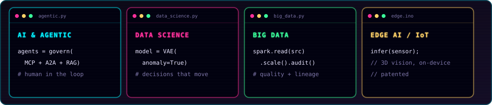
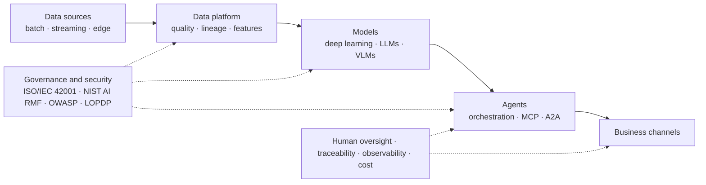

**Enterprise-scale AI architecture** · Quito, Ecuador · [LinkedIn](https://www.linkedin.com/in/asaravia)

I design AI systems end to end (data and models, agent orchestration, security, observability, cost) and govern them against ISO/IEC 42001 and Ecuador's LOPDP. Production work is under employer confidentiality; the public repositories are reference implementations on public data.

Lifelong learner. I like building, breaking and explaining things, so you'll find labs, notebooks and learning paths here more than polished products.

## Four fronts, one system

## Results in production

Technical lead of a 10-person cross-functional team (DevOps, QA, senior engineers, cloud, solution, data and security architects) across the full lifecycle: feasibility, business case, budget readiness and delivery to operations.

## Reference architecture

A generic pattern, not a description of any employer's system.

## How a human + agent team operates

I lead hybrid teams: human specialists and virtual agent teams, driven by specifications, explicit invariants and automated quality gates (spec-driven design). The goal is a **one-pizza agentic team**: small, autonomous and accountable. Inspired by McKinsey's *Rewired* work on rebuilding tech talent.

- **Specifications first:** invariants and quality gates written down so human and virtual teams build the same thing.
- **Governance and security by design, from day one:** OWASP Top 10 for LLM and agentic applications, risk matrices, least privilege.
- **Human oversight and traceability** in every agent, aligned with ISO/IEC 42001 and LOPDP.
- **Observability and cost as requirements**, from MVP to production load.

## Public technical work

| Front | Repository | What it demonstrates |
|---|---|---|
| AI & Agentic | [`taller-ia-cibersecurity`](https://github.com/basaravia/taller-ia-cibersecurity) | Hands-on lab for OWASP LLM and Agentic risks: 20 scenario branches with checklists, a LangGraph agent CLI, a multi-agent mesh sandbox and two OWASP notebooks |
| AI & Agentic | [`langchain-mcp-duckduckgo`](https://github.com/basaravia/langchain-mcp-duckduckgo) | Agent with a remote MCP server and a local model |
| AI & Agentic | [`agente_sp2sp`](https://github.com/basaravia/agente_sp2sp) | Spanish conversational agent with RAG, LLM and audio processing |
| Data Science | [`document-parsing-dl-mllm`](https://github.com/basaravia/document-parsing-dl-mllm) | Content extraction and layout identification with deep learning and multimodal models |
| Data Science | [`img-similarity`](https://github.com/basaravia/img-similarity) | Siamese CNN and metric learning for image similarity |
| Learning | [`advanced-ai-path`](https://github.com/basaravia/advanced-ai-path) | Structured path from fundamentals to scalable AI architectures |
| Edge AI & IoT | [`iot_codes`](https://github.com/basaravia/iot_codes) · [`Laboratorio_IoT_AI6_UIO`](https://github.com/basaravia/Laboratorio_IoT_AI6_UIO) | Raspberry Pi and IoT course material and hands-on lab |

## Research, patent and community

- International patent, Edge AI inference with 3D vision (Universidad Indoamérica)
- Variational autoencoders for fraud and anomaly detection on highly imbalanced data; PySpark pipelines at scale
- MSc Data Science, PUCE. MSc studies in Computational Intelligence, COPPE/UFRJ (coursework completed)
- Teaching and community: Saturdays.AI, tinyML Foundation, IEEE CIS and RAS

Resumen en español

Arquitecto principal de IA, líder técnico y líder de auditoría y gobierno de IA. Diseño sistemas de IA de punta a punta (datos, modelos, orquestación de agentes, seguridad, observabilidad y costos) y los gobierno con ISO/IEC 42001 y la LOPDP. Lidero equipos híbridos de especialistas humanos y agentes virtuales, guiados por especificaciones, hacia el equipo agéntico de una pizza, inspirado en el trabajo de McKinsey (*Rewired*) sobre talento tecnológico. Resultados en producción: agente de IA generativa en 200 agencias (de ~20 min a ≤ 8 s, +5.000 usuarios, 80 % de satisfacción; Premio FELABAN 2026, primer lugar en Latinoamérica) y detección de fraude para un canal de 4 millones de usuarios. El trabajo de producción está bajo confidencialidad; los repositorios públicos son implementaciones de referencia con datos públicos.

